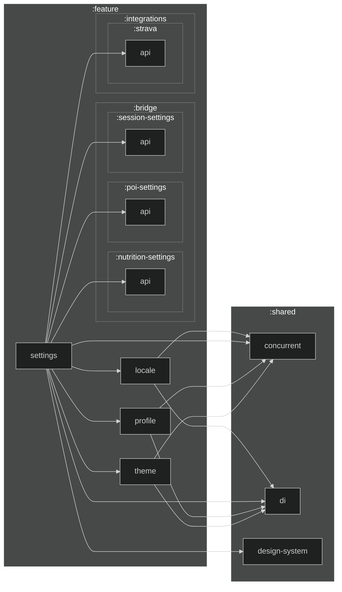

# Settings Feature Dependency Graph


# Session Feature Dependency Graph

```mermaid
%%{
  init: {
    'theme': 'dark'
  }
}%%

graph LR
  subgraph :feature
    :feature:theme["theme"]
    :feature:theme["theme"]
    subgraph :session
      :feature:session:nav-graph["nav-graph"]
      :feature:session:completion["completion"]
      :feature:session:history["history"]
      :feature:session:share["share"]
      :feature:session:stats-display["stats-display"]
      :feature:session:tracking["tracking"]
      :feature:session:domain["domain"]
      :feature:session:route-render["route-render"]
      :feature:session:data["data"]
      :feature:session:domain["domain"]
      :feature:session:init["init"]
      :feature:session:data["data"]
      :feature:session:route-render["route-render"]
      :feature:session:completion["completion"]
      :feature:session:stats-display["stats-display"]
      :feature:session:share["share"]
      :feature:session:data["data"]
      :feature:session:history["history"]
    end
    subgraph :bridge
      subgraph :connection-session
        :feature:bridge:connection-session:api["api"]
      end
      subgraph :nutrition-session
        :feature:bridge:nutrition-session:api["api"]
      end
      subgraph :profile-session
        :feature:bridge:profile-session:api["api"]
      end
    end
    subgraph :integrations
      subgraph :strava
        :feature:integrations:strava:api["api"]
      end
    end
  end
  subgraph :shared
    :shared:concurrent["concurrent"]
    :shared:design-system["design-system"]
    :shared:di["di"]
    :shared:ble["ble"]
    :shared:error["error"]
    :shared:altitude["altitude"]
    :shared:distance["distance"]
    :shared:id["id"]
    :shared:map["map"]
    :shared:map["map"]
    :shared:graphics["graphics"]
    :shared:error["error"]
    :shared:gpx["gpx"]
    :shared:ble["ble"]
    subgraph :location
      :shared:location:domain["domain"]
      :shared:location:data["data"]
      :shared:location:data["data"]
      :shared:location:domain["domain"]
    end
  end

  :feature:session:nav-graph --> :shared:concurrent
  :feature:session:nav-graph --> :shared:design-system
  :feature:session:nav-graph --> :shared:di
  :feature:session:nav-graph --> :feature:session:completion
  :feature:session:nav-graph --> :feature:session:history
  :feature:session:nav-graph --> :feature:session:share
  :feature:session:nav-graph --> :feature:session:stats-display
  :feature:session:tracking --> :feature:session:domain
  :feature:session:tracking --> :feature:session:route-render
  :feature:session:tracking --> :shared:concurrent
  :feature:session:tracking --> :shared:design-system
  :feature:session:tracking --> :shared:di
  :feature:session:tracking --> :feature:session:stats-display
  :feature:session:tracking --> :shared:ble
  :feature:session:tracking --> :shared:error
  :feature:session:tracking --> :shared:location:domain
  :feature:session:tracking --> :shared:location:data
  :feature:session:tracking --> :feature:bridge:connection-session:api
  :feature:session:tracking --> :feature:bridge:nutrition-session:api
  :feature:session:tracking --> :feature:theme
  :feature:session:tracking --> :feature:integrations:strava:api
  :feature:session:tracking --> :feature:session:data
  :feature:session:domain --> :shared:altitude
  :feature:session:domain --> :shared:concurrent
  :feature:session:domain --> :shared:distance
  :feature:session:domain --> :shared:id
  :feature:session:domain --> :shared:location:domain
  :feature:session:domain --> :feature:bridge:profile-session:api
  :feature:session:init --> :feature:session:domain
  :feature:session:init --> :shared:concurrent
  :feature:session:init --> :shared:design-system
  :feature:session:init --> :shared:di
  :feature:session:init --> :feature:session:data
  :feature:session:init --> :shared:altitude
  :feature:session:init --> :shared:distance
  :feature:session:init --> :shared:error
  :feature:session:init --> :shared:id
  :feature:session:init --> :shared:location:domain
  :feature:session:init --> :shared:location:data
  :feature:session:init --> :feature:bridge:profile-session:api
  :feature:session:route-render --> :feature:session:domain
  :feature:session:route-render --> :shared:concurrent
  :feature:session:route-render --> :shared:design-system
  :feature:session:route-render --> :shared:di
  :feature:session:route-render --> :feature:session:stats-display
  :feature:session:route-render --> :shared:map
  :feature:session:route-render --> :feature:session:data
  :shared:map --> :shared:graphics
  :feature:session:completion --> :feature:session:domain
  :feature:session:completion --> :feature:session:route-render
  :feature:session:completion --> :shared:concurrent
  :feature:session:completion --> :shared:design-system
  :feature:session:completion --> :shared:di
  :feature:session:completion --> :feature:session:stats-display
  :feature:session:completion --> :shared:error
  :feature:session:completion --> :shared:graphics
  :feature:session:completion --> :shared:location:domain
  :feature:session:completion --> :shared:map
  :feature:session:completion --> :feature:session:data
  :shared:error --> :shared:concurrent
  :shared:error --> :shared:design-system
  :shared:error --> :shared:di
  :feature:session:stats-display --> :feature:session:domain
  :feature:session:stats-display --> :shared:concurrent
  :feature:session:stats-display --> :shared:design-system
  :feature:session:stats-display --> :shared:di
  :feature:session:share --> :feature:session:domain
  :feature:session:share --> :feature:session:route-render
  :feature:session:share --> :shared:concurrent
  :feature:session:share --> :shared:design-system
  :feature:session:share --> :shared:di
  :feature:session:share --> :feature:session:stats-display
  :feature:session:share --> :shared:gpx
  :feature:session:share --> :shared:location:domain
  :feature:session:share --> :feature:integrations:strava:api
  :feature:session:share --> :feature:session:data
  :shared:location:data --> :shared:location:domain
  :shared:location:data --> :shared:concurrent
  :shared:location:data --> :shared:di
  :feature:theme --> :shared:concurrent
  :feature:theme --> :shared:di
  :shared:ble --> :shared:concurrent
  :feature:session:data --> :feature:session:domain
  :feature:session:data --> :shared:concurrent
  :feature:session:data --> :shared:di
  :feature:session:history --> :feature:session:domain
  :feature:session:history --> :shared:concurrent
  :feature:session:history --> :shared:design-system
  :feature:session:history --> :shared:di
  :feature:session:history --> :feature:session:stats-display
  :feature:session:history --> :feature:session:data
```


# All Features Dependency Graph

```mermaid
%%{
  init: {
    'theme': 'dark'
  }
}%%

graph LR
  :app["app"]
  subgraph :feature
    :feature:connections["connections"]
    :feature:dashboard["dashboard"]
    :feature:destinations["destinations"]
    :feature:locale["locale"]
    :feature:nutrition["nutrition"]
    :feature:poi["poi"]
    :feature:profile["profile"]
    :feature:settings["settings"]
    :feature:theme["theme"]
    subgraph :bridge
      subgraph :connection-session
        :feature:bridge:connection-session:api["api"]
        :feature:bridge:connection-session:impl["impl"]
      end
      subgraph :destination-nutrition
        :feature:bridge:destination-nutrition:api["api"]
        :feature:bridge:destination-nutrition:impl["impl"]
      end
      subgraph :destination-poi
        :feature:bridge:destination-poi:api["api"]
        :feature:bridge:destination-poi:impl["impl"]
      end
      subgraph :destination-session
        :feature:bridge:destination-session:api["api"]
        :feature:bridge:destination-session:impl["impl"]
      end
      subgraph :nutrition-session
        :feature:bridge:nutrition-session:api["api"]
        :feature:bridge:nutrition-session:impl["impl"]
      end
      subgraph :nutrition-settings
        :feature:bridge:nutrition-settings:api["api"]
        :feature:bridge:nutrition-settings:impl["impl"]
      end
      subgraph :poi-settings
        :feature:bridge:poi-settings:api["api"]
        :feature:bridge:poi-settings:impl["impl"]
      end
      subgraph :profile-session
        :feature:bridge:profile-session:api["api"]
        :feature:bridge:profile-session:impl["impl"]
      end
      subgraph :session-settings
        :feature:bridge:session-settings:api["api"]
        :feature:bridge:session-settings:impl["impl"]
      end
      subgraph :session-strava
        :feature:bridge:session-strava:api["api"]
        :feature:bridge:session-strava:impl["impl"]
      end
    end
    subgraph :integrations
      subgraph :strava
        :feature:integrations:strava:api["api"]
        :feature:integrations:strava:impl["impl"]
      end
    end
    subgraph :sensor
      :feature:sensor:power["power"]
    end
    subgraph :session
      :feature:session:data["data"]
      :feature:session:init["init"]
      :feature:session:nav-graph["nav-graph"]
      :feature:session:tracking["tracking"]
    end
  end

  :app --> :feature:connections
  :app --> :feature:bridge:connection-session:api
  :app --> :feature:bridge:connection-session:impl
  :app --> :feature:bridge:destination-nutrition:api
  :app --> :feature:bridge:destination-nutrition:impl
  :app --> :feature:bridge:destination-poi:api
  :app --> :feature:bridge:destination-poi:impl
  :app --> :feature:bridge:destination-session:api
  :app --> :feature:bridge:destination-session:impl
  :app --> :feature:bridge:nutrition-session:api
  :app --> :feature:bridge:nutrition-session:impl
  :app --> :feature:bridge:nutrition-settings:api
  :app --> :feature:bridge:nutrition-settings:impl
  :app --> :feature:bridge:poi-settings:api
  :app --> :feature:bridge:poi-settings:impl
  :app --> :feature:bridge:profile-session:api
  :app --> :feature:bridge:profile-session:impl
  :app --> :feature:bridge:session-settings:api
  :app --> :feature:bridge:session-settings:impl
  :app --> :feature:bridge:session-strava:api
  :app --> :feature:bridge:session-strava:impl
  :app --> :feature:dashboard
  :app --> :feature:destinations
  :app --> :feature:integrations:strava:api
  :app --> :feature:integrations:strava:impl
  :app --> :feature:locale
  :app --> :feature:nutrition
  :app --> :feature:poi
  :app --> :feature:profile
  :app --> :feature:sensor:power
  :app --> :feature:session:data
  :app --> :feature:session:init
  :app --> :feature:session:nav-graph
  :app --> :feature:session:tracking
  :app --> :feature:settings
  :app --> :feature:theme

classDef focus fill:#769566,stroke:#fff,stroke-width:2px,color:#fff;
class :feature:connections focus
class :feature:bridge:connection-session:api focus
class :feature:bridge:connection-session:impl focus
class :feature:bridge:destination-nutrition:api focus
class :feature:bridge:destination-nutrition:impl focus
class :feature:bridge:destination-poi:api focus
class :feature:bridge:destination-poi:impl focus
class :feature:bridge:destination-session:api focus
class :feature:bridge:destination-session:impl focus
class :feature:bridge:nutrition-session:api focus
class :feature:bridge:nutrition-session:impl focus
class :feature:bridge:nutrition-settings:api focus
class :feature:bridge:nutrition-settings:impl focus
class :feature:bridge:poi-settings:api focus
class :feature:bridge:poi-settings:impl focus
class :feature:bridge:profile-session:api focus
class :feature:bridge:profile-session:impl focus
class :feature:bridge:session-settings:api focus
class :feature:bridge:session-settings:impl focus
class :feature:bridge:session-strava:api focus
class :feature:bridge:session-strava:impl focus
class :feature:dashboard focus
class :feature:destinations focus
class :feature:integrations:strava:api focus
class :feature:integrations:strava:impl focus
class :feature:locale focus
class :feature:nutrition focus
class :feature:poi focus
class :feature:profile focus
class :feature:sensor:power focus
class :feature:session:data focus
class :feature:session:init focus
class :feature:session:nav-graph focus
class :feature:session:tracking focus
class :feature:settings focus
class :feature:theme focus
```


# Module Dependency Graph

```mermaid
%%{
  init: {
    'theme': 'neutral'
  }
}%%

graph LR

```